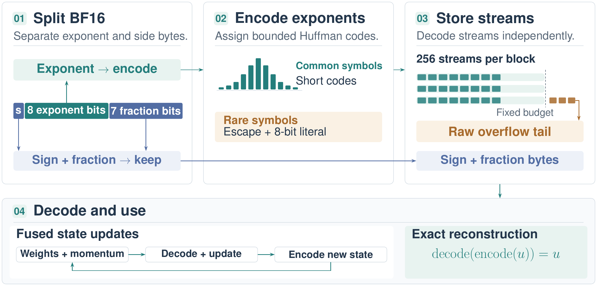

# LCT — Lossless Compression for PyTorch Tensors

<!-- Replace #paper with the paper URL when available. -->
[](#paper)

LCT is a lossless tensor compression scheme for training and inference with PyTorch. BF16 tensors are compressed by up to 1.4X memory reduction with no loss of precision and minimal overhead. Tensors are compressed using Huffman coding, and losslessly reconstructed. Full training is supported, including weights, activations and optimizer state. Kernels are written in Trition, with an optional TileLang backend.

[](figures/graphical_abstract.pdf)

## Requirements

- Python 3.14 (deferred type annotations).
- CUDA GPU.
- Triton, NumPy, and SciPy.
- Optional: TileLang (`tilelang>=0.1.8`) when using the TileLang backend.


## Setup

Clone the repository:

```bash
git clone https://github.com/Maxzhu123/lossless_compression.git
cd lossless_compression
```

With CUDA-enabled PyTorch installed, add the remaining dependencies:

```bash
python -m pip install numpy scipy triton
```

Run the examples from the repository root, or add the directory containing `LCT/` to your Python path.

## Quick start

Compress a BF16 tensor, restore it, and compare the underlying bits:

```python
import torch

from LCT.comp_format import DistType, Distribution
from LCT.operations import compress, decompress

x = torch.randn(1024, 1024, device="cuda", dtype=torch.bfloat16)
distribution = Distribution(DistType.GAUSSIAN)

packed = compress(x, distribution=distribution)
restored = decompress(packed)

assert restored.shape == x.shape
assert torch.equal(x.view(torch.int16), restored.view(torch.int16))

dense_bytes = x.numel() * x.element_size()
packed_bytes = packed.memory_size()
print(f"Dense: {dense_bytes:,} bytes")
print(f"Compressed: {packed_bytes:,} bytes")
print(f"Compression ratio: {dense_bytes / packed_bytes:.2f}x")
```

The first call compiles and autotunes kernels. Compression ratios depend on the data, padding, and overflow storage; small tensors can grow after compression.

`memory_size()` counts tensor storage and its allocated buffer region. Shared codebook tables, unused buffer capacity, and temporary workspace are excluded.

The codec preserves BF16 bits. An FP32-to-BF16 conversion before compression still loses precision. `compress()` detaches its input; use the autograd functions in `LCT/components/` for training.

## Configuration

### Distributions

`Distribution` selects a codebook family and storage layout:

```python
from LCT.comp_format import DistType, Distribution, NoiseLevel

distribution = Distribution(
    DistType.LAPLACE,
    param=1.0,
    mean=0.0,
    zero_prob=0.5,
    noise_level=NoiseLevel.SPARSE,
)
```

Families: `EMPIRICAL`, `GAUSSIAN`, `LAPLACE`, `GAMMA`.

Layouts: `CLEAN`, `MEDIUM`, `HIGH`, `SPARSE`. The layout determines the maximum compression ratio.

### Shared buffer

Use `TensorBuffer` to share overflow storage across compressed tensors to avoid host synchronization:

```python
from LCT.tensor_buffer import TensorBuffer

buffer = TensorBuffer(64 * 2**20, device="cuda")
buffered = compress(x, distribution=distribution, buffer=buffer)
restored = decompress(buffered)
buffered.free()  # Release its overflow region after the final use.
```

Size the buffer for all live allocations. Keep it alive until its tensors are released, and do not reset it while any are in use. Do not read a compressed tensor after calling `free()`.

### TileLang backend

Install the optional dependency:

```bash
python -m pip install 'tilelang>=0.1.8'
```

Enable it before running codec operations:

```python
from LCT import config

config.use_tilelang = True
```

Triton remains required for supporting kernels. Set `use_tilelang = False` to use the default Triton codec.

## Modules

| Module | Purpose |
| --- | --- |
| [`operations.py`](LCT/operations.py) | Compression, decompression, and operations on compressed tensors |
| [`comp_format.py`](LCT/comp_format.py) | Distribution and storage-layout configuration |
| [`config.py`](LCT/config.py) | Backend selection and runtime settings |
| [`comp_tensor.py`](LCT/comp_tensor.py) | `CompressedTensor` storage, memory accounting, and buffer release |
| [`LCTensor.py`](LCT/LCTensor.py) | `LCTTensor` wrapper and supported in-place updates |
| [`tensor_buffer.py`](LCT/tensor_buffer.py) | Shared GPU overflow allocator |
| [`components/`](LCT/components/) | Autograd functions, layers, and optimizers |
| [`compression/`](LCT/compression/) | Probability models and Huffman tables |
| [`codec/`](LCT/codec/) | Encoding, decoding, and pointwise operations |
| [`kernels/`](LCT/kernels/) | Triton and TileLang implementations and GPU dispatch |

`LCTTensor` raises `NotImplementedError` for unsupported tensor operations. Compressed weights are not registered as `nn.Parameter` objects; use `named_trainable_tensors()` to enumerate them and decode them when saving checkpoints.

## Training example

See [train_gpt_lct.py](examples/nanogpt/train_gpt_lct.py) for nanoGPT training with weight, activation, and Muon momentum compression. Each can be enabled separately. [test_setup.py](examples/nanogpt/benchmark_setups.py) measures training time and peak GPU memory using the same model and optimizers.

Both scripts require FineWeb token shards in `examples/nanogpt/data/fineweb10B/`.

Prepare the data once using [fineweb.py](examples/nanogpt/data/fineweb.py), adapted from [modded-nanoGPT](https://github.com/KellerJordan/modded-nanogpt/blob/master/data/fineweb.py):

```bash
python -m pip install -r examples/nanogpt/data/requirements.txt
python -m examples.nanogpt.data.fineweb
```

This downloads the FineWeb 10B sample and tokenizes it with GPT-2 into 100-million-token shards. The first shard is validation data; the rest are training data. The token files take about 20 GB, plus the Hugging Face dataset cache. Use `--workers N` to limit tokenization workers. Rerunning preprocessing overwrites the generated shards; training does not download data automatically.

Run from the repository root:

```bash
python -m examples.nanogpt.train_gpt_lct
python -m examples.nanogpt.test_setup
```

## Benchmarks

[examples/benchmarks/](examples/benchmarks/) contains compression and pointwise benchmarks, along with synthetic data generators and correctness checks.

```bash
python -m examples.benchmarks.pointwise_ops
python -m examples.benchmarks.prepare
```

Edit settings in each script before running. These benchmarks generate their own inputs and require CUDA. CSV results are written to `examples/benchmarks/results/`.

## Paper

Coming soon.

## TODO

- [ ] FP8 support

### GPU support

All recent NVIDIA GPUs should be supported. However, GPU-specific autotuning configurations and kernels will be added to maximise performance. Tuning support list: 

- [x] RTX 3090
- [x] RTX 4090
- [x] RTX 5090
- [x] A100
- [ ] H100
- [ ] H200
- [ ] B200
